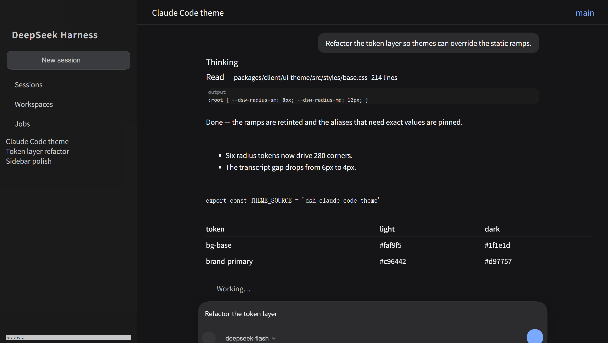
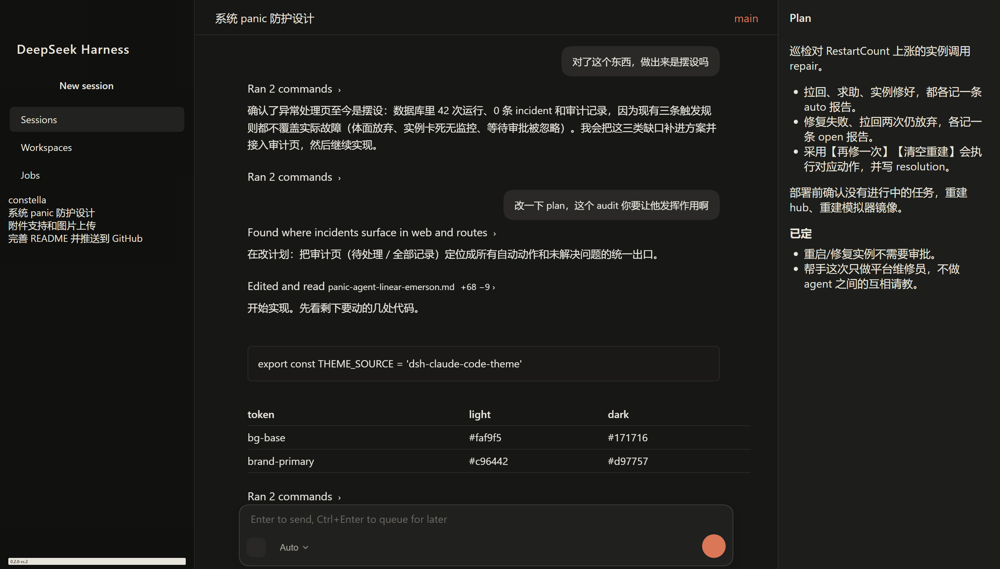
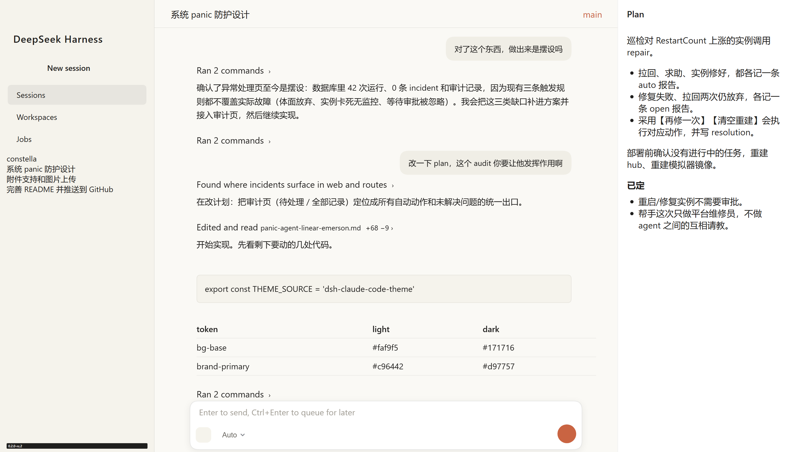

<div align="center">

# dsh-claude-code-theme

**把 Claude Desktop 的视觉语言搬到 DeepSeek Harness Web GUI。**

暖纸质中性色、赤陶色强调色、适合阅读的正文、安静的层叠表面，
以及一张连续的输入卡片 —— 全部通过 DSH 自身的主题扩展点生效，不修改它的样式表。

[](https://www.npmjs.com/package/dsh-claude-code-theme)
[](./LICENSE)

</div>

## 改造前后

原版 DSH —— 偏蓝画布上的右对齐气泡、12–28px 的柔和圆角，
以及一个带圆形发送按钮的悬浮输入卡片：



应用主题后 —— 更深的侧边栏、抬升的右侧面板、为阅读而排版的正文、
紧凑的工具摘要，以及一张连续的输入卡片：



浅色模式，Claude 的米白画布配白色浮起面板：



---

## 安装

```sh
dsh plugin install dsh-claude-code-theme
```

或者把这一行加进你的 profile `cordis.patch.yml`，并把包加进
profile 的 `dsh.profile.bundles`：

```yaml
- insert:
    - id: claude-code-theme
      name: dsh-claude-code-theme
```

刷新 Web GUI 即可。没有需要打开的开关：主题叠加在你当前使用的调色板之上，
所以 `light`、`dark` 和 `system` 都照常工作。

## 改变了什么

**配色。** DSH 的设计系统有三层令牌，主题在每一层上都工作：

| 层级 | 是什么 | 主题做了什么 |
| --- | --- | --- |
| `--dsw-static-*` | 原始色阶 | 把 DSH 偏蓝的灰阶改成 Claude 的暖纸灰，把 DeepSeek 蓝改成赤陶色。语义层通过这些色阶解析，所以仅这一层就重新着色了大部分界面。 |
| `--dsw-alias-*` | 组件真正消费的语义角色 | 固定 Claude 有意区别对待的角色：浮起面板之下的米白画布、赤陶色主按钮与聚焦环、暖色细线，以及暗色下不再刺眼的正文色。 |
| `--dsw-specific-*` | 具名表面 | 调整侧边栏、输入框、气泡、菜单和代码表面。 |

**表面层级。** Claude Desktop 用层叠表达深度而不是压平，所以主题给每一列各自的层级，
而不是共用一种灰：

| 区域 | 深色 | 浅色 |
| --- | --- | --- |
| 侧边栏 | `#111110`（最深） | `#f5f3ec` |
| 画布 | `#171716` | `#faf9f5` |
| 浮起面板 —— 卡片、输入框、右侧面板 | `#1d1d1b` | `#ffffff` |

右侧面板变成用一条细线分隔的浮起表面，而不是漂浮的独立卡片。

**几何。** DSH 把 **280 条 `border-radius` 声明收敛在六个 `--dsw-radius-*` 令牌**上
（统计自全部 179 个已发布的 UI bundle），所以主题直接改这套比例尺：

| 令牌 | DSH | 主题 |
| --- | --- | --- |
| `--dsw-radius-xs` | 4px | 4px |
| `--dsw-radius-sm` | 8px | 6px |
| `--dsw-radius-md` | 12px | 8px |
| `--dsw-radius-lg` | 16px | 12px |
| `--dsw-radius-xl` | 20px | 16px |
| `--dsw-radius-panel` | 28px | 20px |

绕过比例尺的圆角，通过稳定的 `data-slot` 与 `data-*` 钩子定位，而不是构建哈希。

**排版。** 这一项最能决定结果读起来像产品还是像戏服。Claude Desktop 是一个阅读界面，
所以对话正文使用 UI 无衬线字体配舒适行高，等宽字体只留给真正是代码的内容：

| | 处理方式 |
| --- | --- |
| 助手正文 | UI 无衬线，1.65 行高，标题不做额外字距 |
| 行内代码、代码块、工具输出 | 等宽 |
| 侧边栏、标题栏、输入框 | UI 无衬线 |
| 代码块语言横幅 | 句首大写，不再全大写喊叫 |

**对话正文。** 你的发言是安静表面上的右对齐气泡；助手的发言是画布上的正文；
工具调用收成单行摘要（`Ran 2 commands ›`）并在原位展开 —— 这正是 Claude Desktop
让长会话保持可扫读的方式。

**输入框。** 一张连续的圆角表面：编辑器与控制行共用一张卡片，中间没有分隔线，
提交按钮是圆形，聚焦时出现柔和的赤陶色光环而不是硬描边。

**外围界面。** 用安静的导航行代替突兀的主按钮；hover 只作用于可用控件；
键盘操作有 `focus-visible` 焦点环；滚动条是细的暖色轨道。

## 自定义

组件层决定的每一项都读取一次声明在 `body` 上的 `--cct-*` 变量，
所以你可以用自己的 CSS 重新调校，而无需改动这个包：

```css
body {
  /* 用衬线字体做阅读面，长文常用这种做法。 */
  --cct-prose: Georgia, "Songti SC", serif;

  /* 更宽松或更紧凑的表面。 */
  --cct-composer-radius: 24px;
  --cct-control-radius: 6px;
  --cct-editor-inset: 20px;
}
```

| 变量 | 默认值 | 用途 |
| --- | --- | --- |
| `--cct-sans` | 系统 UI 字体栈 | UI 字体，含侧边栏与输入框 |
| `--cct-prose` | `var(--cct-sans)` | 仅用于助手正文的字体 |
| `--cct-mono` | DSH 的代码字体栈 | 代码、工具输出与路径 |
| `--cct-control-radius` | `8px` | 按钮、行、chip、代码块 |
| `--cct-composer-radius` | `18px` | 输入框表面 |
| `--cct-editor-inset` | `16px` | 输入文字距边缘的距离 |
| `--cct-focus` | 品牌主色 | 聚焦环颜色 |

如果要改配色，就在上面再叠一层 —— 后叠的层按令牌逐个生效：

```js
ctx.theme.overrideTokens('my-tweaks', {
  '--dsw-alias-brand-primary': { light: '#c96442', dark: '#d97757' },
})
```

## 实现方式

插件由浏览器半边和一个惰性的宿主行组成。

浏览器半边（`lib/client.js`）只做两件事，且都在同一个 Cordis effect 内，
所以卸载或 HMR 会完整移除主题：

1. 用 174 个 `{ light, dark }` 令牌对调用
   `ctx.theme.overrideTokens('dsh-claude-code-theme', …)`。这是 DSH 官方的
   第三方主题扩展点。服务会把这一层叠在当前调色板之上，`ui-layout` 再把它写成
   `<body>` 上的内联自定义属性 —— 因此主题无需 `!important` 就能压过基础调色板样式表，
   也因此覆盖 `--dsw-static-*` 色阶会传播到每一个由它解析出的语义别名。
2. 以 `<style data-plugin-css>` 标签注入组件样式表，与 DSH 自带插件的做法一致。

这半边没有任何运行时依赖 —— 不需要 React，也不需要 schema 库。
它不导入其他插件的代码，不注册键盘快捷键，也不触碰会话状态。

### 组件层如何经受 DSH 升级

按优先级使用两类钩子：

1. **`data-*` 钩子与 slot 锚点** —— `[data-slot="sidebar"]`、
   `[data-slot="rightbar"]`、`[data-conversation-region="chat"]`、
   `[data-composer-card]`、`[data-chat-flow-kind]`。这些是组件公开的接口。
2. **CSS Module 类名中语义的那一半** —— `cJsG2q_bubble` 只有前缀是哈希，
   `bubble` 是稳定的，所以规则匹配 `[class*="_bubble"]`，并由其上方的区域钩子限定作用域。
   选择器里永远不会出现构建哈希。

`renderSlot()` 会在每一层父盒子与它的占用者之间插入一个内联
`display:contents` 的 `div[data-slot="…"]`。这个锚点对布局透明，
但会打断 `parent > child` 链，所以这里的写法是顺着锚点写，而不是绕过它。

当 DSH 重命名某个局部名或钩子时，最坏的结果是某条规则不再匹配 ——
主题会退化，但不会让应用崩溃。

## 开发

```sh
npm install
npm test        # 类型检查、构建、CSS 校验、行为级 smoke test
```

`npm test` 不是装饰。它用 lightningcss 解析样式表；把样式表读取的每个 DSH 令牌
与白名单比对，避免拼写错误静默失效；拒绝任何含构建哈希的选择器；
并让构建产物通过 `window.__ModuleLoader__.load` 在一个桩 DOM 上真实执行，
确认它叠加了唯一一层格式正确的令牌，并且只发布一张可被完整移除的样式表。

视觉效果对照一个用 DSH 自己发布的组件 CSS 搭建的复刻页面来检查，
因此改动是在真实层叠上评估的，而不是在手工近似上。

## 兼容性

基于 DSH `0.2.0-rc.2` 构建并验证。主题只依赖公开的 `theme` 服务和 UI 组件公开的
DOM 钩子，因此预期能跨补丁版本继续工作；某个局部名被重命名时，退化范围限于一条规则。

## 发布

```sh
npm test
npm version patch
npm publish
git push --follow-tags
```

`prepublishOnly` 会跑完整测试，所以坏掉的构建无法进入 registry。

## 许可

MIT
